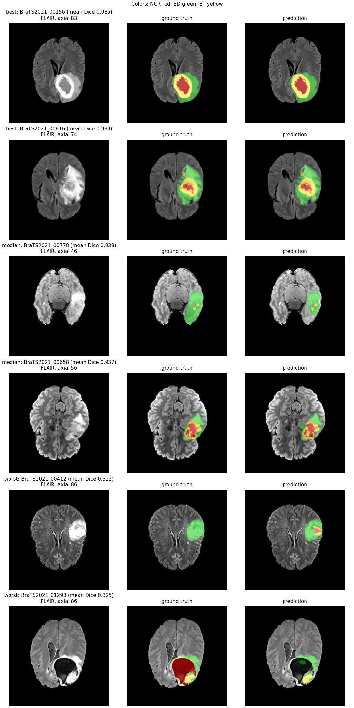
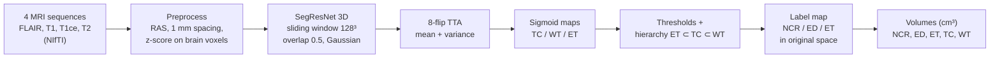

# Brain Tumor Segmentation & Volumetric Quantification

3D segmentation of gliomas in multi-sequence brain MRI (FLAIR, T1, T1ce, T2) into
**necrotic core (NCR)**, **peritumoral edema (ED)** and **enhancing tumor (ET)**, with
per-region volumes in cm³ (NCR, ED, ET, tumor core TC, whole tumor WT). Trained on
BraTS 2021 with [MONAI](https://monai.io/) on a free Kaggle T4 and served as a Gradio
app on Hugging Face ZeroGPU. MRI only.

> **Disclaimer:** research and education only. Not a medical device and not for clinical
> use. The model has only been evaluated on held-out BraTS 2021 cases (pre-operative
> gliomas, skull-stripped and co-registered); it has no external validation.

- **Live demo:** <https://huggingface.co/spaces/roshan160705/brain-tumor-seg>
- **Model weights + model card:** <https://huggingface.co/roshan160705/brats-segresnet>

## Results (BraTS 2021, held-out test split, 125 cases)

Main model: SegResNet (4.70 M parameters), checkpoint from epoch 55 (best validation
mean Dice), 8-flip test-time augmentation (TTA), thresholds [TC 0.5, WT 0.3, ET 0.5]
chosen on the validation split. Source: [`results/segresnet_dice/summary.json`](results/segresnet_dice/summary.json).

| Region | Dice (mean ± std) | Dice (median) | HD95 mm (mean) | HD95 mm (median) |
|---|---|---|---|---|
| Whole tumor (WT) | 0.9295 ± 0.0708 | 0.9515 | 6.56 | 2.00 |
| Tumor core (TC) | 0.9109 ± 0.1537 | 0.9635 | 3.82 | 1.73 |
| Enhancing tumor (ET) | 0.8873 ± 0.1339 | 0.9297 | 3.40 | 1.41 |
| **Mean of regions** | **0.9093** | | | |

**Volume agreement** (predicted vs. ground-truth volume per case; bias = mean of
prediction − ground truth):

| Region | MAE (cm³) | Mean abs. % error | Pearson r | Bias (cm³) |
|---|---|---|---|---|
| WT | 5.63 | 7.4 % | 0.981 | +0.52 |
| TC | 4.22 | 164 % | 0.917 | −2.28 |
| ET | 2.63 | 104 % | 0.919 | +0.72 |
| ED | 6.24 | 22.5 % | 0.959 | +2.81 |
| NCR | 4.93 | 186 % | 0.807 | −3.01 |

Whole-tumor volume is reliable (r = 0.981, 7.4 % error). The large percentage errors for
the sub-regions come from cases where the true region is tiny: a few cm³ of absolute
error is hundreds of percent of a near-empty region (cases with an empty ground-truth
region are excluded from the % error). Bland–Altman and scatter plots:
[`bland_altman.png`](results/segresnet_dice/bland_altman.png),
[`volume_scatter.png`](results/segresnet_dice/volume_scatter.png).



*Best, median and worst test cases (FLAIR; NCR red, ED green, ET yellow). The worst
cases are an under-segmented necrotic cavity and a case where the model predicts tumor
core inside what the annotators labelled edema.*

### Baseline comparison: SegResNet vs. UNet3D

Same data, loss, schedule (60 epochs) and inference. Matched setting: TTA on, threshold
0.5 for every region. Source: [`results/model_comparison.md`](results/model_comparison.md)
(built by `scripts/compare_models.py`).

| | SegResNet | UNet3D |
|---|---|---|
| Parameters | 4.70 M | 4.81 M |
| Best val mean Dice (epoch) | 0.8838 (55) | 0.8637 (40) |
| Test Dice WT / TC / ET | 0.9299 / 0.9109 / 0.8873 | 0.9202 / 0.8967 / 0.8577 |
| **Test Dice mean** | **0.9094** | **0.8915** |
| Test HD95 WT / TC / ET (mm) | 5.74 / 3.82 / 3.40 | 10.79 / 5.80 / 9.49 |
| Inference s/case (T4, TTA) | 14.8 | 4.6 |

SegResNet is better on every region. In paired per-case Wilcoxon tests the Dice
difference is significant for TC (better in 98 of 125 cases, p = 4.9e-9) and ET (99 of
125, p = 1.8e-12). UNet3D's HD95 is 2–3× higher for WT and ET, i.e. it produces more
false-positive islands far from the tumor. UNet3D is about 3× faster at inference
(timings come from separate Kaggle sessions).

### Ablations (SegResNet, test split)

From [`results/segresnet_dice/ablation.csv`](results/segresnet_dice/ablation.csv),
all from the same checkpoint:

| Variant | Dice WT | Dice TC | Dice ET | Mean | HD95 WT / TC / ET (mm) |
|---|---|---|---|---|---|
| No TTA, threshold 0.5 | 0.9264 | 0.9087 | 0.8838 | 0.9063 | 6.09 / 4.42 / 3.70 |
| TTA, threshold 0.5 | 0.9299 | 0.9109 | 0.8873 | **0.9094** | 5.74 / 3.82 / 3.40 |
| TTA, WT threshold 0.3 (main) | 0.9295 | 0.9109 | 0.8873 | 0.9092 | 6.56 / 3.82 / 3.40 |

- **TTA** adds +0.003 mean Dice and lowers HD95 for every region.
- **WT threshold 0.3** was chosen on the validation split, where it improved WT Dice
  from 0.8922 to 0.8978 ([`threshold_grid.csv`](results/segresnet_dice_tta_val/threshold_grid.csv)).
  On the test split it made no difference to Dice and a slightly worse WT HD95. It is
  reported as-is and was not re-tuned on test.
- **Connected-component post-processing** (dropping components < 100 voxels and small
  ET) did not help SegResNet on validation ([`segresnet_dice_val/ablation.csv`](results/segresnet_dice_val/ablation.csv))
  and is off.

### Metric conventions

Dice and HD95 (MONAI, symmetric 95th-percentile Hausdorff distance in mm) per region.
Empty masks follow BraTS: if prediction and ground truth are both empty, Dice = 1 and
HD95 = 0 mm; if exactly one is empty, Dice = 0 and HD95 = 373.13 mm. Volumes are voxel
counts × voxel volume from the NIfTI affine.

## Method



- **Data:** BraTS 2021 Task 1 training set (1,251 cases with labels), split once with
  seed 42 into 1,001 train / 125 validation / 125 test cases
  ([`data/splits.json`](data/splits.json)). The test split was only used for the final
  evaluations.
- **Targets:** three overlapping sigmoid channels, TC (NCR + ET), WT (NCR + ED + ET) and
  ET, converted back to BraTS labels with the hierarchy ET ⊂ TC ⊂ WT.
- **Preprocessing:** orient to RAS, resample to 1 mm (a no-op for BraTS, needed for
  uploads), crop to the brain, per-channel z-score over non-zero voxels.
- **Augmentation:** two random 128³ crops per case, random flips on all axes, random
  intensity scale (±10 %) and shift (±0.1 in z-score units).
- **Model:** MONAI SegResNet (init filters 16, blocks down [1, 2, 2, 4], dropout 0.2).
  Baseline: MONAI residual UNet (channels 16–256, 2 residual units per level).
- **Loss:** soft Dice on sigmoid outputs (squared denominator, smoothing 1).
- **Training:** AdamW (lr 1e-4, weight decay 1e-5), 3 warm-up epochs then cosine decay,
  60 epochs, mixed precision, validation every 5 epochs on full volumes, best checkpoint
  by validation mean Dice. Resumable across Kaggle's 12 h sessions. Training curves:
  [`segresnet_dice_train_log.csv`](results/segresnet_dice_train_log.csv),
  [`unet3d_dice_train_log.csv`](results/unet3d_dice_train_log.csv).
- **Inference:** sliding window, optional 8-flip TTA (whose variance gives an
  uncertainty map in the app), thresholds, and inversion of all spatial transforms so
  the output segmentation matches the uploaded image grid.

Configs: [`configs/segresnet.yaml`](configs/segresnet.yaml),
[`configs/unet3d.yaml`](configs/unet3d.yaml). All settings live in the YAML files and
are saved inside each checkpoint.

## Web app

The [Space](https://huggingface.co/spaces/roshan160705/brain-tumor-seg) takes the four
sequences of one patient as `.nii` / `.nii.gz` (co-registered and skull-stripped, as in
BraTS), runs the model on a ZeroGPU GPU and shows:

- an axial / coronal / sagittal slice viewer with a color overlay and opacity slider,
  starting at the slice with the largest tumor area;
- an uncertainty heatmap when TTA is on;
- a rotatable **3D view** of the tumor inside a translucent brain outline (necrotic core,
  enhancing tumor and edema as nested surfaces, true to scale in mm; built with marching
  cubes in [`btseg/mesh.py`](src/btseg/mesh.py));
- the volume table (NCR, ED, ET, TC, WT in cm³);
- downloads: `segmentation.nii.gz` (BraTS labels, original image space), a report
  (JSON / CSV) and the 3D model (`tumor_3d.glb`).

Inputs are validated (all four present, 3D, same shape and matching affines). The app
also runs locally on CPU: `python app/app.py`.

## Repository layout

```
src/btseg/            the package: all logic lives here
  data/               case discovery, splits, transforms, label <-> region conversion, cache
  models/ losses.py   model factory (SegResNet, UNet3D, SwinUNETR) and losses
  train.py            training CLI (resume, time limit, CSV log)
  infer.py            Predictor: sliding window, TTA, inverse transforms; CLI
  postprocess.py      thresholds, region hierarchy, optional component filtering
  volumetrics.py      region volumes in cm³
  metrics.py          Dice / HD95 with BraTS edge cases
  mesh.py             3D surface meshes (.glb) for the app
  evaluate.py         test-split evaluation, ablations, figures -> results/
  export.py           ONNX export + parity check
app/                  Gradio app for the Hugging Face Space
configs/              YAML configs per model
notebooks/            Kaggle notebook (clones this repo and calls the CLIs)
scripts/              Kaggle push, model upload, Space build, comparison, splits
results/              every reported number and figure
tests/                pytest suite on synthetic data (CPU)
```

## Reproducing

### Local setup (CPU)

Python 3.10 (a recent 3.10.x patch release: 3.10.0 has a dataclass bug that breaks
pytest 9).

```bash
python -m venv .venv
.venv/Scripts/activate        # Windows; on Linux/macOS: source .venv/bin/activate
pip install torch==2.13.0 --index-url https://download.pytorch.org/whl/cpu
pip install -r requirements.txt
pip install -e .
ruff check .
pytest
```

The tests use small synthetic volumes, so no BraTS data is needed.

### Training and evaluation on Kaggle

The notebook [`notebooks/kaggle_train.ipynb`](notebooks/kaggle_train.ipynb) clones this
repo, finds the BraTS 2021 dataset (`dschettler8845/brats-2021-task1`), and runs the
training and evaluation CLIs on a T4. Its first cell explains the settings. From a
terminal with the Kaggle CLI:

```bash
python scripts/kaggle_push.py --user <kaggle-user> --mode full --config configs/segresnet.yaml
```

```bash
kaggle kernels push -p build/kaggle/brats-segresnet-train
```

Use `--resume` to continue in a new 12 h session from the previous version's `last.pt`,
and `--mode eval --eval-args "--split test --tta --ablation"` for the test evaluation.
Copy `results/<run_name>/` from the kernel output into this repo, then:

```bash
python scripts/compare_models.py
```

### Running inference locally

```bash
python -m btseg.infer --ckpt roshan160705/brats-segresnet --case-dir path/to/case --tta
```

`--case-dir` holds the four sequences named as in BraTS (`<case>_flair.nii.gz`,
`_t1`, `_t1ce`, `_t2`).
It writes `seg.nii.gz` (BraTS labels) and `volumes.json`. `--ckpt` also accepts a local
`best.pt`.

### Publishing the model and the Space

```bash
python scripts/upload_weights.py --repo-id <hf-user>/brats-segresnet --run-dir runs/segresnet_dice --results results/segresnet_dice
```

```bash
python scripts/build_space.py --space-id <hf-user>/brain-tumor-seg --model-repo <hf-user>/brats-segresnet
```

Both take `--dry-run` to only build the folder. Log in first with `hf auth login`.

## Limitations

- **MRI only, gliomas only, pre-operative only.** Trained on BraTS 2021 adult gliomas;
  other tumor types, post-operative scans and CT are out of scope.
- **Input format.** Expects the four BraTS sequences, co-registered and skull-stripped.
  Raw clinical scans need the BraTS preprocessing (registration, skull stripping) first.
- **No external validation.** All numbers come from a held-out split of the same
  dataset; performance on other scanners and institutions is unknown.
- **Small sub-regions.** Relative volume errors for NCR, ET and TC are large when the
  region is tiny, and ET is the hardest region (lowest Dice).
- **Compute budget.** 60 epochs on a free T4; longer training, ensembling or larger
  models (e.g. SwinUNETR) were not explored.

## Data and license

BraTS 2021 data are distributed under the terms of the
[RSNA-ASNR-MICCAI BraTS 2021 challenge](https://www.synapse.org/brats2021); they are not
included in this repository. The trained weights are released for research and
education only, under the same non-clinical terms.

## References

1. U. Baid et al., "The RSNA-ASNR-MICCAI BraTS 2021 Benchmark on Brain Tumor
   Segmentation and Radiogenomic Classification," arXiv:2107.02314, 2021.
2. B. H. Menze et al., "The Multimodal Brain Tumor Image Segmentation Benchmark
   (BRATS)," *IEEE Trans. Med. Imaging*, 34(10), 2015.
3. S. Bakas et al., "Advancing The Cancer Genome Atlas glioma MRI collections with
   expert segmentation labels and radiomic features," *Scientific Data*, 4, 2017.
4. A. Myronenko, "3D MRI brain tumor segmentation using autoencoder regularization,"
   BrainLes (MICCAI), 2018.
5. Ö. Çiçek et al., "3D U-Net: Learning Dense Volumetric Segmentation from Sparse
   Annotation," MICCAI, 2016.
6. M. J. Cardoso et al., "MONAI: An open-source framework for deep learning in
   healthcare," arXiv:2211.02701, 2022.
